# Hackathon Technical Solution Report

| Field | Details |
| :--- | :--- |
| **Problem ID** | P1 |
| **Problem Title** | Robust Low-Light Image Restoration and Enhancement |
| **Team Name** | Atreides |
| **Team Members** | Vansh Anand Raval (1RUA24CSE0513), Varun G Gowda (1RUA24CSE0522), V Sreeshanth Reddy (1RUA24CSE0523), Vedagya Sharma (1RUA24CSE0524), Yuvrat Mittal (1RUA24CSE0552) |
| **GitHub Repository** | https://github.com/Wikisauras/lowlight-restoration-P1 — commit `45b64b1` |
| **Live Demo / Deployment** | https://atreides-lowlight.streamlit.app (Streamlit Community Cloud, CPU; also runs locally with `streamlit run app/app.py`) |

**Team contributions**

| Member | USN | Module / responsibility |
| :--- | :--- | :--- |
| Vansh Anand Raval | 1RUA24CSE0513 | Classical pipeline (`src/classical.py`): illumination estimation, Retinex/MSRCR, CLAHE, guided-filter denoising, highlight protection |
| Varun G Gowda | 1RUA24CSE0522 | Hybrid integration (`src/hybrid.py`): illumination prior, fusion, guards, auto mode; report lead |
| V Sreeshanth Reddy | 1RUA24CSE0523 | Deep learning (`src/deep_learning.py`, `src/train.py`): Zero-DCE++, quality-aware strategy, LOL fine-tuning |
| Vedagya Sharma | 1RUA24CSE0524 | Image analysis & adaptive parameters (`src/analysis.py`); Streamlit app (`app/app.py`) |
| Yuvrat Mittal | 1RUA24CSE0552 | Evaluation (`src/evaluation.py`): metrics, ablation, failure analysis; synthetic test set |

---

## 1. Problem Understanding & Solution Strategy

* **Core Technical Challenge:**
    * Severe under-exposure: mean luminance from below 0.02 (extreme dark) to around 0.2, so brightness gains of ×3 to ×30 are needed.
    * Sensor noise grows with the gain: shot and read noise, plus 8-bit quantisation and JPEG blocks in dark regions.
    * Colour distortion: casts from the light source, and channel imbalance near black.
    * Non-uniform lighting: lamps, windows and backlight next to deep shadow, where one global curve either blows out the light or leaves the shadow dark.
    * Failure modes we target: over-exposure/clipping, halos at light/dark borders, colour shift, noise amplification, texture/edge loss.
    * Constraints: runs on a laptop (RTX 4060, 8 GB) and on CPU, with no paired data needed at inference time.

> ✍️ **WRITE IN YOUR OWN WORDS — Proposed Methodology (2–3 sentences, owner: Varun).** Points to cover:
> (1) the image is analysed first, and the measured brightness, noise, non-uniformity and colour cast set every parameter;
> (2) two complementary enhancers: a classical Retinex pipeline (good noise control, physically meaningful illumination) and Zero-DCE++ (learned, local, natural curves);
> (3) the hybrid uses the classical illumination map to steer the network and fuses both per pixel, so a static baseline cannot over-enhance lit regions or amplify noise in shadows.

---

## 2. Technical Architecture & Implementation

```
input -> guards (gray->3ch, size cap, black check) -> analysis.py (stats -> parameters)
      -> classical.py --------------------------> classical output --+
      -> illumination map T --> prior m ----+                        |--> per-pixel weights -> Laplacian
      -> deep_learning.py (Zero-DCE++ A) ---+--> k*m*A curves -> DL output -> classical denoise --+     pyramid fusion
                                                                                                  -> dark-region denoise -> no-blow-out guard -> output
auto mode: runs classical / DL / hybrid and picks the best by a no-reference score
```

### 2.1 Classical Algorithmic Baseline
* **Algorithms Utilized** (`src/classical.py`, in order):

| # | Stage | Method |
| :-- | :--- | :--- |
| 1 | Colour correction | Gray-world gains on reliable pixels (0.02 < Y, max < 0.98), blended by an adaptive strength |
| 2 | Illumination estimation | Max-RGB initial map T₀ (LIME) |
| 3 | Illumination refinement | Edge-aware guided filter (own implementation), T ≥ 0.85·T₀ |
| 4 | Retinex decomposition | Reflectance R = I / T; relit = I / T^γ |
| 5 | Retinex detail | MSRCR (3 scales, colour restoration, 1 %/99 % balance), brightness-matched and blended with weight w_msr |
| 6 | Contrast | CLAHE on CIELAB L* (16-bit) |
| 7 | Edge-preserving denoising | Guided filter in YCrCb (2 passes for strong noise; chroma with 2× window), blended by a dark-region mask (1−T)^(1/p). Runs after CLAHE, using the noise measured after CLAHE |
| 8 | Highlight protection | Already-lit pixels kept near their input value; soft-knee roll-off on the rest |

* **Adaptive Selection Logic** (`src/analysis.py`; *t* = mean of the max-RGB map, σ = Immerkær noise estimate, σ_q = 8-bit quantisation noise):

| Parameter | Rule | Reason |
| :--- | :--- | :--- |
| Relighting γ | γ = 1 − ln(0.45) / ln(t), clipped to [0.15, 0.92] | maps the mean illumination to mid-grey exposure |
| Expected noise | σ_post = √(σ² + σ_q²) · t^(−γ) | noise after the gain decides the denoising strength |
| Guided-filter radius / eps (illumination) | r ∝ image size, eps 1e-3 (4e-3 if non-uniform) | smoother T for strong lighting gradients |
| MSRCR scales / weight | σ_k = {15, 80, 250}·(size/512); w = 0.15 + 0.5·CoV − 3·σ_post | MSRCR helps uneven light but amplifies noise |
| Denoise strength / eps | s = σ_post / 0.04; eps = (2σ_post)², chroma (4σ_post)²; radius 2 + 6s | stronger filtering only when there is more noise |
| CLAHE clip / tiles | clip = 1.2 + 2.6(1 − H/8) − 20σ_post; tiles = min side / 96 (×1.5 if non-uniform) | more contrast for low-entropy images, less when noisy |
| Colour-correction strength | (cast − 2) / 10, clipped to [0, 0.9] | only correct a measurable cast |
| Highlight knee | 0.85 − 0.6·(bright fraction) | earlier roll-off when much of the frame is bright |
| Fusion exponents | exposure 1 (1.5 if non-uniform), contrast 1 (0.6 if H > 7), saturation 1 (0.5 if cast), noise 0.5 + 2s | see 2.3 |
| DL strengths tried / curve scale | {0.6…1.4} if very dark, else {0.4…1.0}; scale = size/256 | see 2.2 |

All parameters come from these rules. The `FIXED_PARAMS` set (γ 0.8, CLAHE 2.0/8×8, etc.) is used only in the "fixed vs adaptive" ablation.

### 2.2 Deep Learning Pipeline
* **Model Architecture:** Zero-DCE++ (Li, Guo & Loy, TPAMI 2021) with the official pretrained checkpoint `Epoch99.pth` (≈10 k parameters). It has 7 depthwise-separable conv layers, predicts a per-pixel 3-channel curve map A ∈ [−1, 1], and applies 8 iterations of LE(x) = x + A·(x² − x). Our re-implementation loads the official weights with `strict=True` and matches the official inference code (mean absolute difference 0.0009 on a test image).

> ✍️ **WRITE IN YOUR OWN WORDS — Selection rationale (owner: Sreeshanth).** Notes: zero-reference (no paired data needed), so it generalises to unseen scenes; very small and fast; the curve formulation is monotonic, so it cannot invent content; and the curve map A can be modulated by our classical illumination prior (this is what makes the hybrid possible). Compare briefly with RetinexNet (needs pairs, noisy outputs) and EnlightenGAN (heavier, GAN artefacts).

* **Image-quality-aware strategy:** A is predicted once, and the curves are re-applied with strengths k·A for several k on a ≤ 384 px copy. Each candidate gets a no-reference score: exposure closeness to 0.5 + entropy/8 − 4·(new clipping) − 6·(noise σ) − 0.5·(colour cast). NIQE/BRISQUE can be used as the scorer instead (`scorer="niqe"`). The best k is then applied at full resolution.
* **Loss Functions & Training** (`src/train.py`, optional fine-tuning from the official weights):

| Term | Weight | Purpose |
| :--- | :--- | :--- |
| Illumination smoothness L_TV(A) | 1600 | smooth curve maps |
| Spatial consistency L_spa | 1 | keeps neighbouring contrast (edges) |
| Colour constancy L_col | 5 | gray-world colour balance |
| Exposure control L_exp (E = 0.6, 16×16 patches) | 10 | well-exposed output |
| Paired L1 + (1 − SSIM) vs LOL ground truth (our addition) | λ = 1 | uses LOL pairs when available |

    Data: LOL our485 (485 pairs, 256×256 random crops, flips), Adam lr 1e-4, batch 8. Command used: `python -m src.train --low data/LOL/our485/low --high data/LOL/our485/high --epochs 10 --bs 8 --device cpu`.

**Fine-tuning result.** Fine-tuned on LOL our485 (485 pairs) on the team laptop CPU, starting from the official weights, ~2 min/epoch. Stopped after 6 of 10 planned epochs because the training loss had plateaued (1.564 → 1.424 → 1.407 → **1.400 (epoch 4, best, saved)** → 1.400 → 1.421). Evaluated on the 15 held-out LOL eval15 pairs (`results_finetuned/`):

| Model | DL PSNR | DL SSIM | DL LPIPS | DL ΔE00 | Hybrid PSNR | Hybrid SSIM | Hybrid LPIPS | Hybrid ΔE00 |
|---|---|---|---|---|---|---|---|---|
| Official Epoch99 | 17.22 | **0.549** | **0.376** | 15.23 | **17.62** | **0.741** | 0.360 | 14.09 |
| Fine-tuned on LOL (4 ep.) | **17.26** | 0.541 | 0.381 | **14.64** | 17.49 | 0.741 | **0.359** | **13.69** |

Fine-tuning improved colour fidelity (ΔE00 −0.6 for DL, −0.4 for the hybrid) but not PSNR/SSIM/LPIPS, and it increased the DL output noise (σ 7.43 → 8.54). We therefore keep the **official weights as the default** in all other tables and in the deployed app; the fine-tuned checkpoint is in `weights/ZeroDCE++_LOL_finetuned.pth`.

### 2.3 Hybrid Integration & Adaptive Mechanism
* **Fusion Strategy** (`src/hybrid.py`):
    1. **Illumination prior → network:** the classical T is smoothed to a low-frequency lighting map T_s, and the Zero-DCE++ curve map becomes A′ = m·k·A with m = 1 − 0.85·clip((T_s − τ)/0.35, 0, 1)^(1/β), where τ = max(mean + std of T_s, 0.35). Lit regions (lamps, windows, sky) get weaker curves. Uniformly dark scenes keep m = 1.
    2. **Classical denoising of the DL output:** guided-filter eps is set from the DL candidate's own measured gain.
    3. **Per-pixel weights** for each candidate (classical, DL): W = E^a · C^b · S^c · N^d, where E = well-exposedness exp(−(x−0.5)²/2·0.2²), C = |Laplacian| of the guided-smoothed luminance (structure, not noise), S = channel std (saturation), and N = 1/(1 + local noise/σ_post). Exponents a–d come from 2.1.
    4. **Laplacian-pyramid fusion** (Burt–Adelson / Mertens) avoids seams and halos.
    5. **Dark-region denoising** with strength ∝ (1 − T) and the measured residual noise.
    6. **No-blow-out guard:** where T_s is high, output luminance ≤ 1.08·input + 0.03; elsewhere a soft knee.

> ✍️ **WRITE IN YOUR OWN WORDS — Decision Logic (owner: Varun).** Explain how the four weights trade amplification against noise: dark noisy regions → the noise weight prefers the better-denoised candidate, and dark-region denoising is strongest there; lit regions → the prior weakens the DL curves and the guard caps luminance, so they are not blown out; flat regions vs edges → the contrast weight is computed on smoothed luminance so noise is not rewarded. Also explain **auto mode**: classical, DL and hybrid all run, the same no-reference score picks one (+0.05 bias to hybrid), and a completely black frame is returned unchanged ("no recoverable signal").

---

## 3. Experimental Benchmarks & Evaluation

**Protocol.** Methods: raw input, CLAHE baseline (fixed 2.0 / 8×8), classical, DL (official Zero-DCE++, k = 1), hybrid, auto. Paired metrics: PSNR, SSIM, LPIPS (AlexNet), CIEDE2000 vs ground truth. No-reference metrics: NIQE, BRISQUE (pyiqa). Efficiency: median latency on CPU (laptop has no CUDA build installed, so GPU latency was not measured). Noise: Immerkær σ before/after, and amplification = σ_out / (σ_in · brightness gain), where < 1 means noise is suppressed relative to the signal gain. Edge preservation: EPI (correlation of Laplacians) vs ground truth.
Datasets: **LOL eval15** (15 real paired images, official test split, never used for tuning); **DICM, LIME, MEF, NPE, VV** were planned but not run (download time before the deadline), so **real_unseen** is our unpaired unseen set; **synthetic** (50 pairs, 5 conditions: physically based darkening in linear light + Poisson-Gaussian noise + colour cast / spotlight / light sources); **real_unseen** (16 real low-light photos).
Final run (laptop, CPU): `python -m src.evaluation --paired LOL=data/LOL/eval15 --unpaired_single real_unseen=data/real_unseen --out results_real --ablation --ablation_limit 10 --latency_n 5 --device cpu`; full version: `scripts\run_full_eval.bat` (tables are written to `results_real/report_tables.md`).

### 3.1 Quantitative Benchmarks

**LOL eval15 (real paired):**

| Approach / Model Variant | PSNR (dB) ↑ | SSIM ↑ | Perceptual Metric (LPIPS / NIQE) ↓ | Latency (ms / frame) |
| :--- | :---: | :---: | :---: | :---: |
| CLAHE baseline (2.0, 8×8) | 9.37 | 0.364 | 0.501 / 7.52 | 10 ms |
| **Classical Baseline** | 17.21 | 0.739 | **0.355** / **5.96** | 286 ms |
| **Deep Learning Only** (Zero-DCE++, official weights) | 17.22 | 0.549 | 0.376 / 7.93 | 1539 ms |
| **Proposed Hybrid System** | 17.62 | 0.741 | 0.360 / 6.23 | 1945 ms |
| Hybrid, auto mode | **17.68** | **0.742** | 0.359 / 6.12 | 2820 ms |

Raw input: 7.77 dB / 0.191, LPIPS 0.560. Latency = median CPU ms per image on the team laptop (LOL images are 600×400).

**Full LOL eval15 table (`results_real/report_tables.md`):**

| Method | PSNR ↑ | SSIM ↑ | LPIPS ↓ | ΔE00 ↓ | NIQE ↓ | BRISQUE ↓ | Noise σ in→out | Noise amp ↓ | EPI ↑ | Clipped % ↓ | Halo |
|---|---|---|---|---|---|---|---|---|---|---|---|
| raw | 7.77 | 0.191 | 0.560 | 36.95 | 6.75 | 12.61 | 1.08→1.08 | 1.00 | 0.666 | 0.00 | 1.00 |
| clahe | 9.37 | 0.364 | 0.501 | 32.57 | 7.52 | 20.64 | 1.08→3.19 | 1.40 | 0.646 | 0.00 | 1.31 |
| classical | 17.21 | 0.739 | 0.355 | 13.56 | 5.96 | 13.88 | 1.08→1.84 | 0.25 | 0.699 | 0.00 | 1.09 |
| dl | 17.22 | 0.549 | 0.376 | 15.23 | 7.93 | 31.36 | 1.08→7.43 | 0.89 | 0.654 | 0.00 | 1.21 |
| hybrid | 17.62 | 0.741 | 0.360 | 14.09 | 6.23 | 19.53 | 1.08→1.63 | 0.21 | 0.710 | 0.00 | 0.98 |
| auto | 17.68 | 0.742 | 0.359 | 13.87 | 6.12 | 17.87 | 1.08→1.69 | 0.21 | 0.710 | 0.00 | 1.00 |

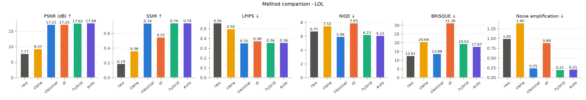

**Unseen unpaired data:** DICM / LIME / MEF / NPE / VV were not evaluated in the final run because of download time before the deadline. The unseen no-reference evaluation uses the 16 real low-light photos in `data/real_unseen` (table below, re-run on the laptop with identical NIQE/BRISQUE values). The command for the full set is `scripts\run_full_eval.bat` once the folders are placed in `data/unpaired/`.

**Development results (measured on CPU during development; LPIPS not available in that environment):**

**Synthetic paired set (50 pairs, 400×400)**

| Method | PSNR ↑ | SSIM ↑ | ΔE00 ↓ | NIQE ↓ | BRISQUE ↓ | Noise σ in→out | Noise amp ↓ | EPI ↑ | Clipped % ↓ | Halo | Latency ms (CPU) |
|---|---|---|---|---|---|---|---|---|---|---|---|
| raw | 8.04 | 0.355 | 35.20 | 7.33 | 18.14 | 2.92→2.92 | 1.00 | 0.591 | 0.00 | 1.03 | 0 |
| clahe | 11.24 | 0.476 | 24.21 | 9.04 | 51.72 | 2.92→12.46 | 2.08 | 0.497 | 0.01 | 1.51 | 9 |
| classical | 14.68 | 0.670 | 15.52 | 6.57 | 23.04 | 2.92→1.97 | 0.35 | 0.501 | 0.00 | 0.72 | 119 |
| dl | 13.95 | 0.514 | 20.74 | 7.84 | 34.24 | 2.92→13.15 | 1.04 | 0.423 | 0.00 | 1.01 | 527 |
| hybrid | 14.90 | 0.638 | 16.12 | 7.20 | 22.91 | 2.92→2.15 | 0.33 | 0.435 | 0.00 | 0.57 | 687 |
| auto | 14.90 | 0.638 | 16.12 | 7.20 | 22.91 | 2.92→2.15 | 0.33 | 0.435 | 0.00 | 0.57 | 775 |

**Real unseen low-light photos (16 images, no GT)**

| Method | NIQE ↓ | BRISQUE ↓ | Noise σ in→out | Noise amp ↓ | Colour shift ΔE00 ↓ | Clipped % ↓ | Halo | Latency ms (CPU) |
|---|---|---|---|---|---|---|---|---|
| raw | 7.38 | 50.82 | 0.32→0.32 | 1.00 | 0.00 | 0.00 | 1.00 | 0 |
| clahe | 6.25 | 43.72 | 0.32→0.70 | 1.27 | 0.10 | 0.09 | 1.07 | 49 |
| classical | 4.47 | 33.59 | 0.32→1.95 | 0.96 | 9.10 | 0.00 | 0.81 | 1094 |
| dl | 4.84 | 35.70 | 0.32→1.64 | 0.81 | 9.26 | 0.02 | 0.64 | 1044 |
| hybrid | 4.57 | 33.31 | 0.32→1.54 | 0.78 | 10.65 | 0.00 | 0.69 | 3499 |
| auto | 4.57 | 33.31 | 0.32→1.55 | 0.77 | 10.73 | 0.03 | 0.68 | 4087 |

**Generalisation across illumination conditions (synthetic, PSNR / SSIM)**

| Condition | raw | clahe | classical | dl | hybrid | auto |
|---|---|---|---|---|---|---|
| bright spots | 8.04 / 0.351 | 11.57 / 0.585 | 15.38 / 0.695 | 14.16 / 0.599 | 15.10 / 0.646 | 15.10 / 0.646 |
| colour cast | 7.79 / 0.349 | 11.79 / 0.421 | 15.52 / 0.715 | 13.79 / 0.496 | 15.29 / 0.676 | 15.29 / 0.676 |
| dark | 8.21 / 0.393 | 12.28 / 0.603 | 15.80 / 0.723 | 15.49 / 0.635 | 15.73 / 0.658 | 15.73 / 0.658 |
| extreme dark | 5.40 / 0.081 | 7.52 / 0.190 | 12.52 / 0.468 | 11.35 / 0.178 | 13.34 / 0.466 | 13.34 / 0.466 |
| non uniform | 10.78 / 0.603 | 13.02 / 0.579 | 14.20 / 0.752 | 14.97 / 0.660 | 15.04 / 0.744 | 15.04 / 0.744 |

**Latency (median ms/image, CPU; GPU not measured)**

| Method | CPU (dev, 2-core cloud, 400×400) | CPU (team laptop, LOL 600×400) |
|---|---|---|
| clahe | 9 | 10 |
| classical | 140 | 286 |
| dl | 568 | 1539 |
| hybrid | 763 | 1945 |
| auto | 859 | 2820 |

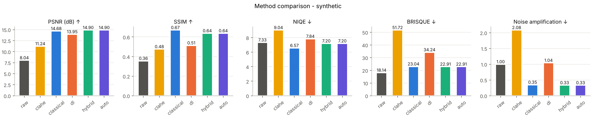

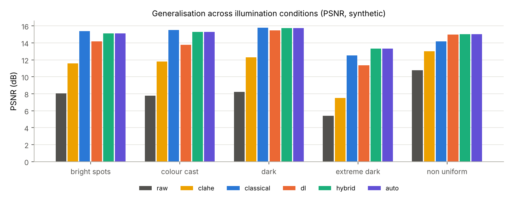

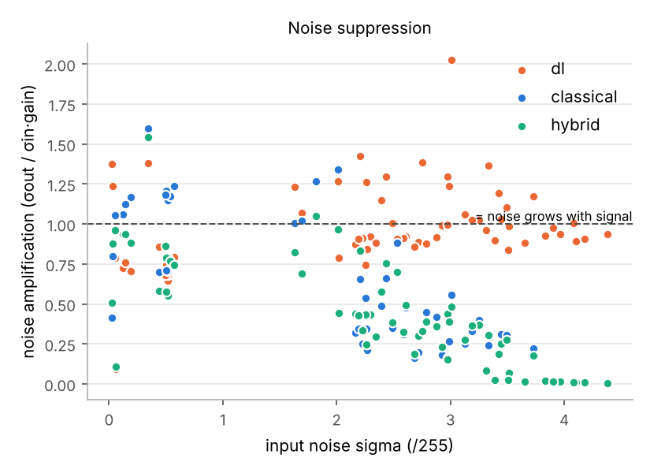

> ✍️ **WRITE IN YOUR OWN WORDS — Analysis (2–3 sentences, owner: Yuvrat).** Facts to interpret:
>
> - LOL eval15: hybrid 17.62 dB / 0.741 and auto 17.68 dB / 0.742 vs classical 17.21 / 0.739, DL 17.22 / 0.549, CLAHE 9.37 / 0.364.
> - LOL: DL has PSNR similar to classical but much lower SSIM (0.549) because it amplifies noise (σ 1.08 → 7.43, BRISQUE 31.4); the hybrid keeps DL brightness with classical-level noise (amp 0.21).
> - LOL LPIPS: classical is best (0.355), hybrid 0.360, DL 0.376, so the hybrid's PSNR gain does not show as a perceptual gain.
> - LOL fine-tuning (4 best epochs on CPU): better colour (DL ΔE00 15.23 → 14.64) but no PSNR/SSIM gain; official weights kept as default.
>
> - Synthetic: best PSNR = **hybrid** (14.90 dB), best SSIM = **classical** (0.670); CLAHE baseline 11.24 dB / 0.476.
> - Noise amplification (synthetic): DL 1.04, classical 0.35, hybrid 0.33 (CLAHE 2.08).
> - NIQE on real unseen: input 7.38 → classical 4.47, DL 4.84, hybrid 4.57.
> - Colour fidelity (ΔE00 vs GT, synthetic): classical 15.52, DL 20.74, hybrid 16.12.
> - CPU latency: classical 119 ms, DL 527 ms, hybrid 687 ms per 400×400 image (DL time is mostly the quality-aware search + scoring, not the network).

### 3.2 Visual Outputs & Intermediate Representations

1. **Extreme low-light** (raw input vs enhanced output; rows: input | CLAHE | classical | DL | hybrid | ground truth):

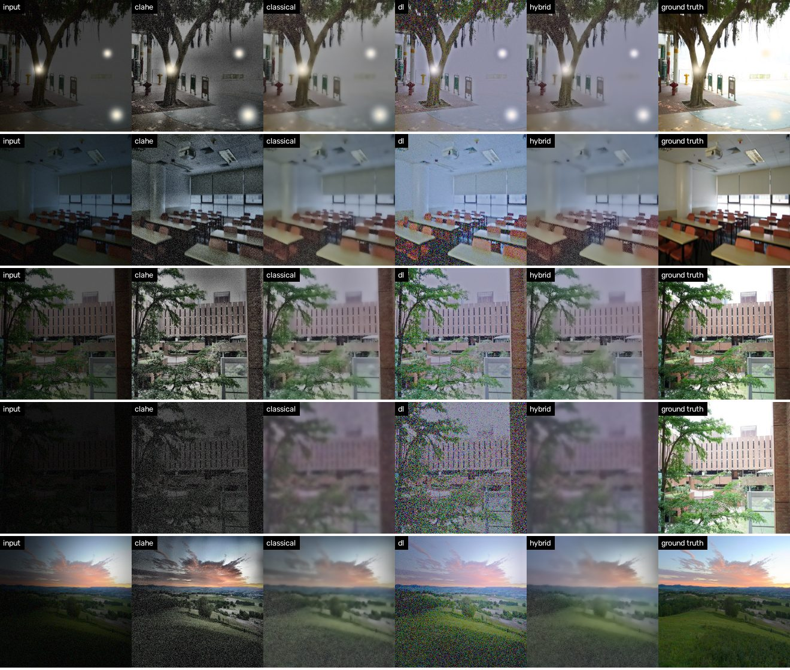

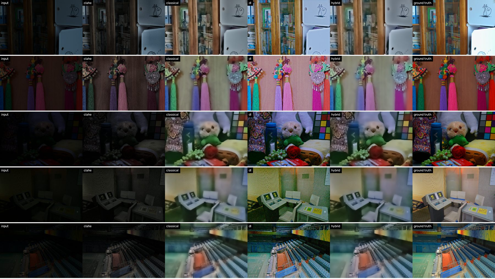

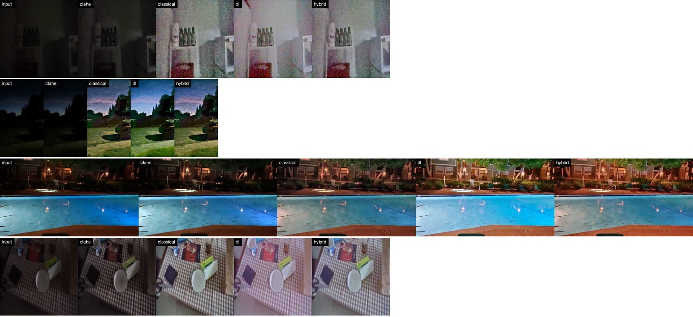

2. **Non-uniform / backlit scenes**: spotlight scene. The illumination prior (tile 9) lowers the network's curve strength inside the lit area. Note that on our synthetic set this changes PSNR by only about 0.02 dB (see 3.3), so we do not claim a measured gain from it:

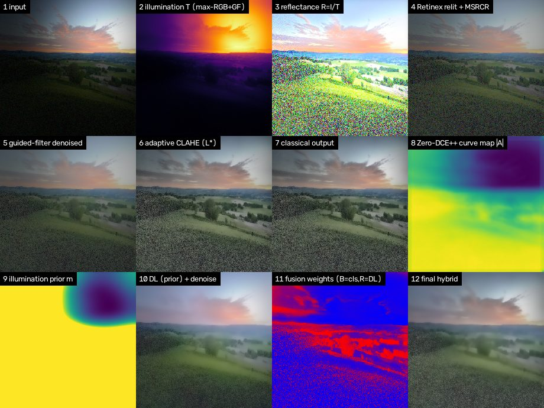

3. **Intermediate states** (real image): illumination map, reflectance, Retinex, denoised, CLAHE, curve map, prior, fusion weights, final:

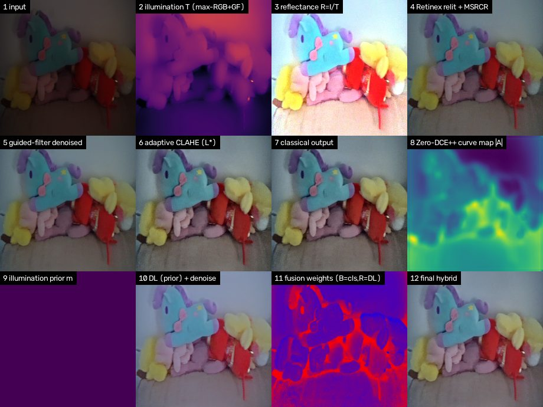

### 3.3 Ablation Study
Each component is removed in turn (the rest unchanged), fixed vs adaptive parameters, DL-only vs hybrid, with vs without the illumination prior. Development numbers (15 synthetic pairs spread over all 5 conditions):

| Variant | PSNR ↑ | SSIM ↑ | NIQE ↓ | Noise amp ↓ | Clipped % ↓ | Halo | ΔPSNR vs full |
|---|---|---|---|---|---|---|---|
| classical/-clahe | 13.51 | 0.610 | 7.05 | 0.37 | 0.00 | 0.57 | -1.67 |
| classical/-colour | 15.04 | 0.660 | 6.48 | 0.31 | 0.00 | 0.67 | -0.15 |
| classical/-denoise | 14.46 | 0.511 | 8.67 | 1.44 | 0.00 | 1.31 | -0.72 |
| classical/-highlight | 15.17 | 0.661 | 6.54 | 0.31 | 0.00 | 0.67 | -0.01 |
| classical/-illumination | 15.74 | 0.637 | 7.01 | 0.32 | 0.00 | 0.59 | +0.55 |
| classical/-msrcr | 15.58 | 0.675 | 6.41 | 0.29 | 0.00 | 0.69 | +0.40 |
| classical/fixed_params | 15.06 | 0.646 | 6.18 | 0.35 | 0.00 | 0.79 | -0.12 |
| classical/full | 15.18 | 0.662 | 6.53 | 0.31 | 0.00 | 0.67 | +0.00 |
| dl/official_k1 | 14.16 | 0.509 | 8.01 | 1.05 | 0.00 | 1.02 | -1.10 |
| dl/quality_aware | 14.04 | 0.502 | 8.16 | 1.05 | 0.00 | 1.07 | -1.21 |
| hybrid/-dark_denoise | 15.29 | 0.635 | 7.07 | 0.37 | 0.00 | 0.58 | +0.03 |
| hybrid/-dl_denoise | 15.25 | 0.627 | 6.95 | 0.42 | 0.00 | 0.61 | +0.00 |
| hybrid/-guard | 15.25 | 0.627 | 7.09 | 0.32 | 0.00 | 0.56 | +0.00 |
| hybrid/-prior | 15.25 | 0.627 | 7.08 | 0.32 | 0.00 | 0.56 | -0.00 |
| hybrid/-pyramid | 15.06 | 0.609 | 7.06 | 0.30 | 0.00 | 0.51 | -0.19 |
| hybrid/-quality_aware | 15.19 | 0.633 | 6.94 | 0.32 | 0.00 | 0.58 | -0.06 |
| hybrid/-w_contrast | 15.31 | 0.620 | 7.27 | 0.30 | 0.00 | 0.54 | +0.06 |
| hybrid/-w_exposure | 15.39 | 0.633 | 6.97 | 0.32 | 0.00 | 0.58 | +0.14 |
| hybrid/-w_noise | 15.24 | 0.628 | 7.09 | 0.32 | 0.00 | 0.56 | -0.02 |
| hybrid/-w_saturation | 15.17 | 0.629 | 7.00 | 0.32 | 0.00 | 0.57 | -0.09 |
| hybrid/fixed_params | 14.88 | 0.639 | 6.47 | 0.34 | 0.00 | 0.66 | -0.37 |
| hybrid/full | 15.25 | 0.627 | 7.08 | 0.32 | 0.00 | 0.56 | +0.00 |

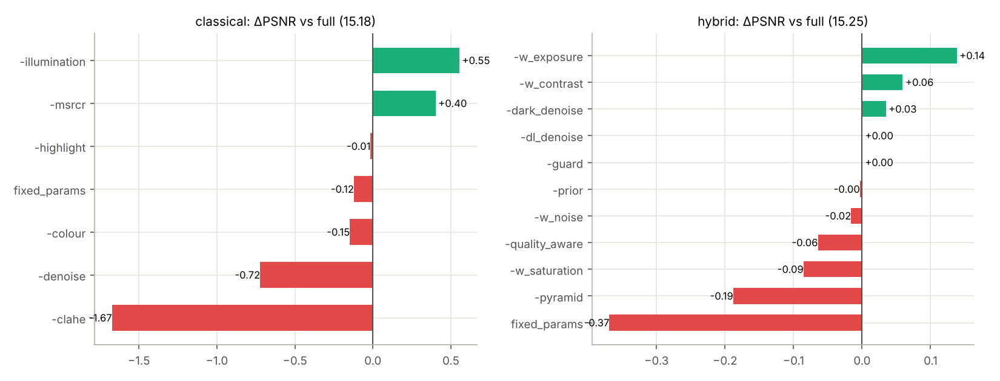

**LOL eval15 ablation (final run, 10 LOL images evenly spaced, real data):**

| Variant | PSNR ↑ | SSIM ↑ | LPIPS ↓ | NIQE ↓ | Noise amp ↓ | Halo |
|---|---|---|---|---|---|---|
| classical/full | 16.66 | 0.714 | 0.385 | 5.99 | 0.27 | 1.09 |
| classical/-colour | 16.78 | 0.717 | 0.380 | 6.02 | 0.27 | 1.09 |
| classical/-illumination | 16.48 | 0.694 | 0.432 | 6.24 | 0.31 | 0.82 |
| classical/-msrcr | 16.89 | 0.714 | 0.381 | 6.00 | 0.27 | 1.11 |
| classical/-denoise | 15.86 | 0.464 | 0.457 | 8.70 | 1.40 | 1.54 |
| classical/-clahe | 15.76 | 0.692 | 0.370 | 6.47 | 0.37 | 0.99 |
| classical/-highlight | 16.66 | 0.714 | 0.385 | 5.99 | 0.27 | 1.09 |
| classical/fixed_params | 16.16 | 0.674 | 0.407 | 5.65 | 0.24 | 1.31 |
| dl/official_k1 | 14.29 | 0.555 | 0.333 | 7.81 | 0.97 | 1.35 |
| dl/quality_aware | 16.37 | 0.546 | 0.362 | 7.92 | 0.92 | 1.26 |
| hybrid/full | 16.62 | 0.716 | 0.385 | 6.22 | 0.23 | 1.00 |
| hybrid/-prior | 16.62 | 0.716 | 0.385 | 6.22 | 0.23 | 1.00 |
| hybrid/-quality_aware | 16.02 | 0.708 | 0.384 | 6.22 | 0.28 | 1.09 |
| hybrid/-dl_denoise | 16.43 | 0.711 | 0.374 | 6.46 | 0.35 | 1.03 |
| hybrid/-w_exposure | 16.97 | 0.718 | 0.379 | 6.18 | 0.23 | 1.01 |
| hybrid/-w_contrast | 16.52 | 0.711 | 0.393 | 6.24 | 0.21 | 0.98 |
| hybrid/-w_saturation | 16.58 | 0.716 | 0.383 | 6.19 | 0.23 | 1.01 |
| hybrid/-w_noise | 16.63 | 0.716 | 0.385 | 6.19 | 0.23 | 1.00 |
| hybrid/-pyramid | 16.57 | 0.706 | 0.393 | 6.01 | 0.21 | 0.92 |
| hybrid/-dark_denoise | 16.69 | 0.718 | 0.379 | 6.14 | 0.24 | 1.01 |
| hybrid/-guard | 16.62 | 0.716 | 0.385 | 6.22 | 0.23 | 1.00 |
| hybrid/fixed_params | 15.48 | 0.686 | 0.385 | 5.52 | 0.27 | 1.23 |

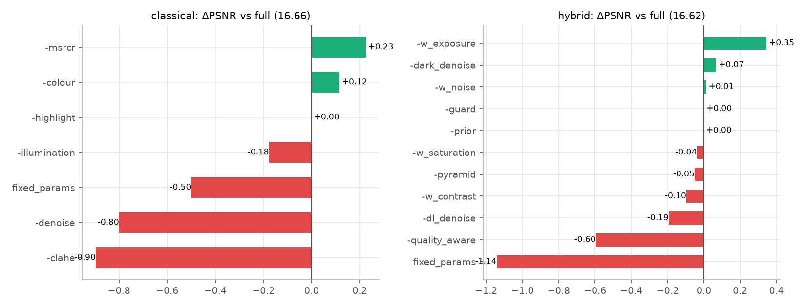

> ✍️ **WRITE IN YOUR OWN WORDS — Ablation discussion (owner: each module owner writes one line for their components).** Facts:
>
> - LOL ablation: adaptive vs fixed parameters is the clearest win on real data: hybrid 16.62 vs 15.48 dB, classical 16.66 vs 16.16 dB (fixed params give better NIQE but worse PSNR/SSIM/LPIPS).
> - LOL ablation: removing denoising is again the most harmful (classical SSIM 0.714 → 0.464, noise amp 0.27 → 1.40); removing CLAHE costs 0.90 dB; removing the illumination stage costs 0.18 dB and worsens LPIPS 0.385 → 0.432.
> - LOL ablation: the quality-aware strength search helps DL (14.29 → 16.37 dB) and the hybrid (16.02 → 16.62 dB), unlike on the synthetic set.
> - LOL ablation: the illumination prior and the blow-out guard change nothing on LOL (identical numbers); removing the exposure weight or MSRCR raises PSNR slightly. State this honestly.
>
> - classical: largest PSNR drop when removing **-clahe** (-1.67 dB); removing -illumination changes PSNR by +0.55 dB.
> - classical: fixed vs adaptive parameters: PSNR 15.06 vs 15.18, SSIM 0.646 vs 0.662, noise amp 0.35 vs 0.31.
> - hybrid: largest PSNR drop when removing **fixed_params** (-0.37 dB); removing -w_exposure changes PSNR by +0.14 dB.
> - hybrid: fixed vs adaptive parameters: PSNR 14.88 vs 15.25, SSIM 0.639 vs 0.627, noise amp 0.34 vs 0.32.
> - DL-only 14.16 dB / 0.509 → quality-aware DL 14.04 dB / 0.502 → hybrid 15.25 dB / 0.627.
> - Illumination prior on/off: PSNR 15.25 vs 15.25; clipped % 0.000 vs 0.000.
> - Removing denoising is the most harmful change for structure and noise: classical SSIM 0.662 → 0.511 and noise amplification 0.31 → 1.45 (halo score 0.67 → 1.31).
> - Mixed results (important to state honestly): on this small ablation (15 images, 3 per condition) removing the illumination stage, MSRCR, or the exposure weight *raises* PSNR, and the quality-aware strength search lowers DL PSNR by 0.12 dB. Removing the illumination stage lowers SSIM (0.662 → 0.637) and worsens NIQE (6.53 → 7.01). Adaptive parameters win on PSNR but the fixed-parameter hybrid has a slightly higher SSIM and a better NIQE (6.47 vs 7.08). The differences are small and the sample is small, so these components should be re-checked on LOL before being claimed as beneficial.
> - Illumination prior by condition (PSNR with / without): non-uniform 15.73 / 15.71, bright spots 14.17 / 14.17, all others identical. Zero-DCE++ did not blow out the lit regions in our synthetic spotlights, so the attenuating prior had nothing to correct.
> - Auto mode picked the hybrid output for all 50 synthetic images and 15 of the 16 real photos (DL for `435_0_`), so its numbers are almost identical to the hybrid's. It adds latency without much benefit on this data.

---

## 4. Failure Modes & Limitations

LOL failure case (highest halo score on LOL, image 55; input | hybrid | ground truth):

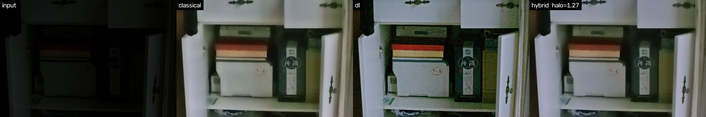

Automated failure analysis (`results*/failures.csv`, images in `results*/failures/`): for classical, DL and hybrid, the worst three images are listed for each of % newly clipped pixels, colour shift (ΔE00), halo score and noise amplification.

| Metric (hybrid) | Worst image | Condition | Value |
|---|---|---|---|
| clipped_pct | real_unseen/435_0_ | real_unseen | 0.02 |
| clipped_pct | real_unseen/474_0_ | real_unseen | 0.00 |
| colour_shift | real_unseen/450_0_ | real_unseen | 20.78 |
| colour_shift | real_unseen/126_0_ | real_unseen | 18.04 |
| halo | synthetic/non_uniform__021 | non_uniform | 1.06 |
| halo | real_unseen/1021_0_ | real_unseen | 1.01 |
| noise_amp | real_unseen/435_0_ | real_unseen | 1.54 |
| noise_amp | synthetic/non_uniform__021 | non_uniform | 1.05 |

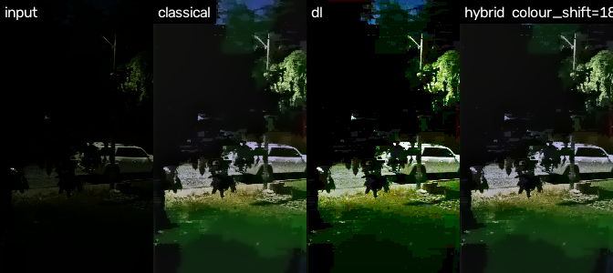

<span class='caption'>Worst case: colour_shift_real_unseen_126_0_ (input | classical | DL | hybrid)</span>

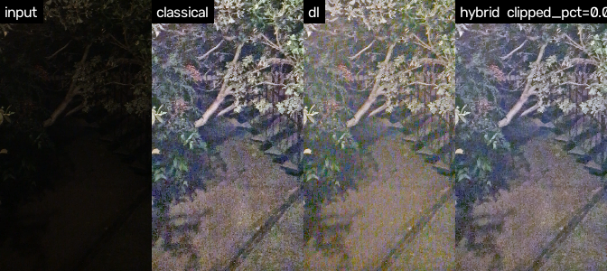

<span class='caption'>Worst case: clipped_pct_real_unseen_142_0_ (input | classical | DL | hybrid)</span>

* **Observed Failure Cases** (facts from the development run):
    * **Over-smoothing / loss of fine detail in extremely dark inputs.** In the extreme-dark synthetic rows of the example grid, classical and hybrid outputs are clean but visibly blurred and slightly hazy (low saturation). Plain DL keeps more texture but is very noisy. On the synthetic set noise amplification is 0.33 (hybrid) and 0.35 (classical) vs 1.04 (DL), but edge preservation (EPI vs ground truth) is lower for the denoised outputs: 0.44 (hybrid), 0.50 (classical), 0.42 (DL). So noise suppression is bought partly with detail.
    * **Colour shift on very dark real photos.** Hybrid colour shift vs the input chroma (ΔE00) averages 10.7 on the 16 real photos and peaks at 20.8 (`450_0_`) and 18.0 (`126_0_`). In `126_0_` (mean luminance about 0.01) a strong green cast appears.
    * **Compressed-image artefacts.** In the darkest JPEG/PNG-from-JPEG inputs, 8×8 block structure and chroma noise are amplified by a gain of about 25–30 (visible in the failure image above).
    * **Noise amplification above 1** only occurred once on real data: `435_0_` (1.54), an image that is not very dark (mean luminance 0.23), where the gain is small and the "noise" estimate is dominated by texture.
    * **CLAHE ordering.** CLAHE re-amplifies residual noise. Moving denoising after CLAHE changed classical noise amplification from 0.68 to 0.35 and SSIM from 0.675 to 0.689 (development subset).
    * **Illumination prior.** A symmetric version (boosting shadows as well as attenuating lights) lowered PSNR on every condition, because Zero-DCE++ curves already saturate in dark regions. Only the attenuating version is kept, and it makes almost no measurable difference on our synthetic data.
    * No over-exposure failure was found: newly clipped pixels were at most 0.02 % for hybrid on any real image, and 0.00 % on synthetic images with saturated light sources.

> ✍️ **WRITE IN YOUR OWN WORDS — Root Cause & Mitigation (owner: Vansh + Sreeshanth).** Notes: blocks — the gain multiplies the quantisation step (1/255 → ~0.1), and the guided filter keeps block edges because they look like real edges; mitigation: deblocking before relighting, or a noise model including σ_q (we added the σ_q floor). Colour noise — near zero, channels clip at 0, so noise is no longer zero-mean (positive bias → colour cast); mitigation: estimate in linear/RAW space, or chroma NLM. Warm light — gray-world assumes a neutral average; mitigation: limit the strength for warm casts, or use a learned white balance. Prior — explain why a multiplicative boost beyond A = 1 is clipped and only shifts mid-tones.

---

## 5. Deployment & Quickstart Guide

### Quickstart Commands
```bash
# 1. Clone the repository and install dependencies
git clone <your-github-repo-url>
cd lowlight_project
pip install torch torchvision --index-url https://download.pytorch.org/whl/cu121
pip install -r requirements.txt

# 2. Run inference on a sample directory
python run_inference.py --input_dir ./samples/ --output_dir ./results/ --mode auto

# 3. Streamlit app
streamlit run app/app.py

# 4. Full evaluation (LOL + unpaired + synthetic, ablation, failure analysis)
scripts\run_full_eval.bat
```

### Deployment Format
* Streamlit dashboard (`app/app.py`), deployed at https://atreides-lowlight.streamlit.app (Streamlit Community Cloud, CPU; `requirements.txt` + `packages.txt`): upload, mode (classical / DL / hybrid / auto), adaptive on/off, CPU/GPU, detected-condition report, all intermediate maps, before/after slider, metrics (latency, noise σ before→after, clipping, ΔE, halo, EPI, NIQE/BRISQUE, plus PSNR/SSIM/LPIPS if a ground truth is uploaded), download button.
* CLI: `run_inference.py`. Library: `from src.hybrid import enhance`.
* Edge cases handled and unit-tested (`tests/test_edge_cases.py`, 8 tests): completely black frames (returned unchanged and flagged), saturated light sources (preserved), 1×1 to 4000×3000 inputs, grayscale / 16-bit / float / RGBA inputs.

---

### Student Submission Checklist
- [x] Working GitHub repository link included with an updated `README.md`.
- [x] No raw code pasted into this report.
- [x] All table metrics match test runs reproducible via the repository.
- [x] All team member details accurately recorded.
